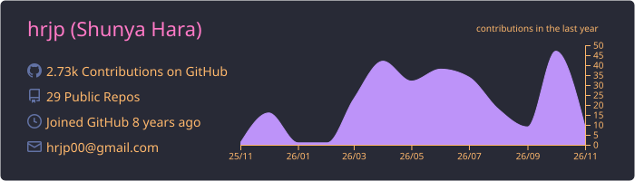

## Portfolio

Explore my robotics projects and research: **[hrjp.github.io](https://hrjp.github.io/)**

<!--## Othello AI -> https://hrjp.github.io/othello-ai/ -->
<!---->

## Projects

<table>
<tr>
<td width="33%" valign="top"><a href="https://hrjp.github.io/creation/autonomous-ai-challenge-2026/"> <strong>Autonomous Driving AI Challenge 2026</strong></a> Four-kart autonomous EV racing; seventh place in the Sim to Real category.</td>
<td width="33%" valign="top"><a href="https://hrjp.github.io/creation/q3dweb/"> <strong>q3dweb</strong></a> Browser and VS Code point cloud viewer.</td>
<td width="33%" valign="top"><a href="https://hrjp.github.io/creation/easys-underwater-robot-2024/"> <strong>Easys Underwater Robot</strong></a> Open-source underwater robot with ROS packages and a simulator.</td>
</tr>
<tr>
<td width="33%" valign="top"><a href="https://hrjp.github.io/creation/autonomous-ai-challenge-2024/"> <strong>Autonomous Driving AI Challenge 2024</strong></a> Autonomous EV kart racing; third place in the final.</td>
<td width="33%" valign="top"><a href="https://hrjp.github.io/creation/juzu-gripper-2023/"> <strong>Juzu Type Gripper</strong></a> A gripper with actively controllable shape and stiffness.</td>
<td width="33%" valign="top"><a href="https://hrjp.github.io/creation/autonomous-ai-challenge-2023/"> <strong>Autonomous Driving AI Challenge 2023</strong></a> Autonomous racing in a simulated competition.</td>
</tr>
<tr>
<td width="33%" valign="top"><a href="https://hrjp.github.io/creation/plat-tsukuba-challenge/"> <strong>plat</strong></a> Autonomous mobile robot that completed Tsukuba Challenge 2023.</td>
<td width="33%" valign="top"><a href="https://hrjp.github.io/creation/quadruped-robot-2020/"> <strong>Quadruped Robot</strong></a> A 3D-printed walking robot with 12 servo motors.</td>
<td width="33%" valign="top"><a href="https://hrjp.github.io/creation/navitoon/"> <strong>Navit(oo)n</strong></a> Autonomous mobile robot navigating urban streets.</td>
</tr>
<tr>
<td width="33%" valign="top"><a href="https://hrjp.github.io/creation/victoon-2018/"> <strong>VICT(OO)N</strong></a> A bottle-throwing robot built for Kosen Robocon 2018.</td>
<td width="33%" valign="top"><a href="https://hrjp.github.io/creation/sarukaninpo-2017/"> <strong>Sarukaninpo</strong></a> A balloon-popping robot built for Kosen Robocon 2017.</td>
<td width="33%"></td>
</tr>
</table>
